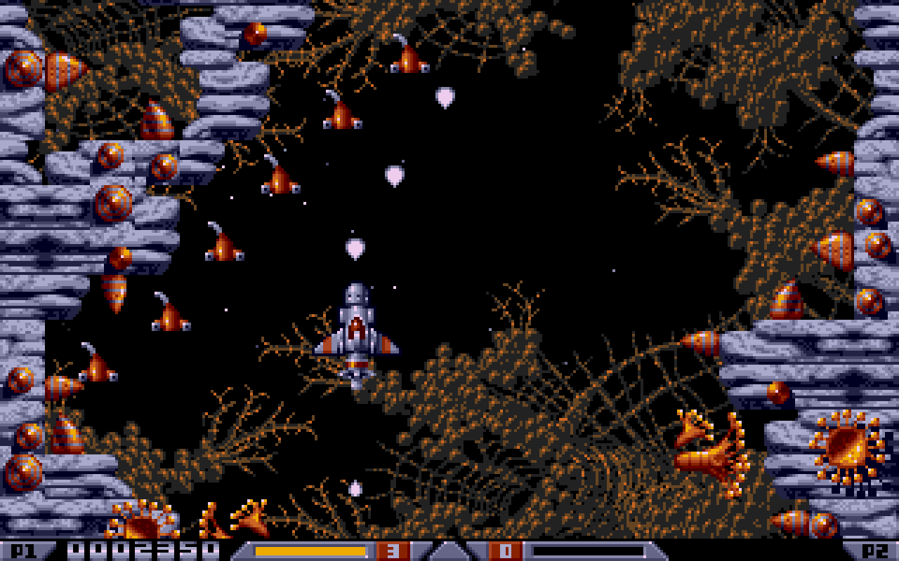
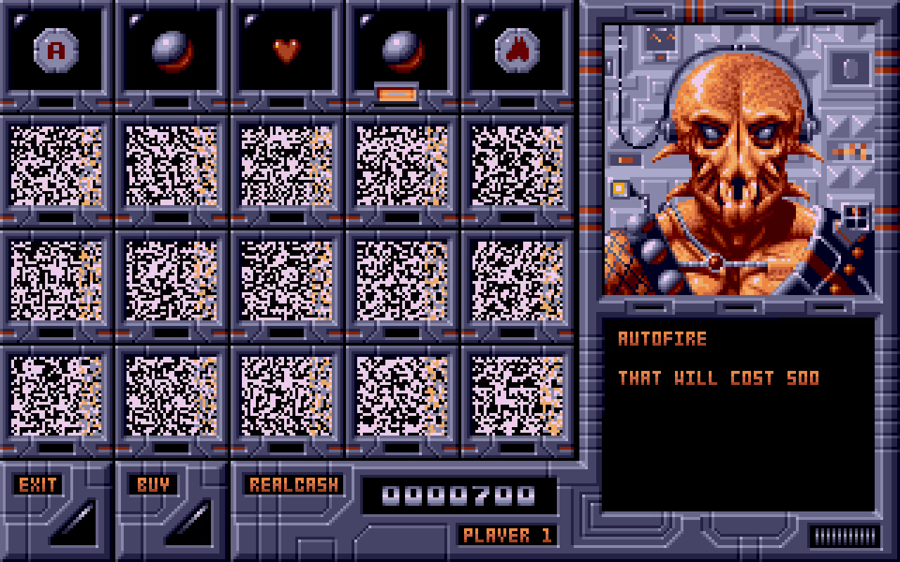
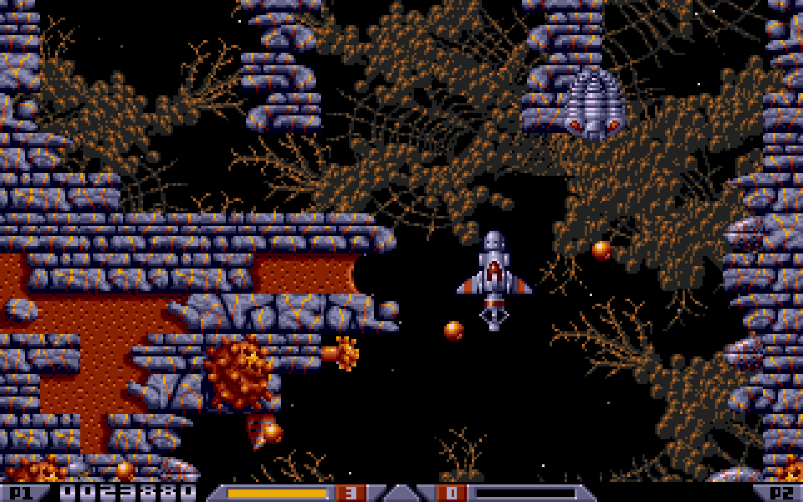

# Xenon 2 Go

A native Go/Ebitengine remake of **Xenon 2: Megablast** for desktop and Android.
Fly through five vertically scrolling stages, destroy enemy formations, collect
cash and equipment, visit the merchant and fight the original compound guardians.

[Watch the presentation on Malakh Software](https://www.malakhsoftware.com/games.html#xenon2).

| First-stage combat | Merchant | Later scenery |
| --- | --- | --- |
|  |  |  |

## Features

- Five stages with their two sections, formations, scenery and guardians.
- Original menu, HUD, loading screens, merchant, credits and ending.
- Weapons, upgrades, cash, shield, lives, continues and checkpoint recovery.
- One or two alternating players.
- Original graphics, music, speech and effects generated from a user-supplied ADF.
- Three-stage automatic demonstration and optional trainer settings.
- Shared desktop and Android game code with touch controls.

## Prepare the resources

Original game data is not included. Follow [the asset setup guide](docs/ASSET_SETUP.md),
then run:

```sh
./scripts/prepare-assets.sh -adf "/path/to/Xenon 2.adf"
GOWORK=off go run ./cmd/xenon2
```

Go 1.26 or newer and the normal Ebitengine desktop prerequisites are required.

## Desktop commands

```sh
GOWORK=off go run ./cmd/xenon2
GOWORK=off go run ./cmd/xenon2 -demo
GOWORK=off go run ./cmd/xenon2 -fullscreen
GOWORK=off go run ./cmd/xenon2 -touch
```

Leave the menu idle for 60 seconds to start the demonstration. Any keyboard,
mouse, gamepad or touch action returns control to the player.

## Controls

| Input | Action |
| --- | --- |
| Arrow keys or WASD | Move the ship or menu selection |
| Space or Ctrl | Fire / confirm |
| Alt | Dive |
| Enter | Confirm a menu or merchant choice |
| P | Pause or resume |
| M | Toggle music |
| F3 | Open trainer settings during play |
| Escape | Return to the attract sequence; quit from the main menu |
| F11 | Toggle fullscreen |
| Standard gamepad stick / D-pad | Move |
| Primary / secondary gamepad buttons | Fire / dive |

The optional trainer menu can provide ships, continues, money, energy,
equipment and a starting level. All trainer options are disabled by default.

## Android

```sh
./scripts/run-android.sh
```

The landscape layout places a virtual joystick and FIRE/DIVE buttons beside the
game picture. ENTER, MENU, PAUSE and CHEATS remain available without covering
the playfield. The activity keeps the display awake while the game is visible.

## Presentation media

With FFmpeg installed, regenerate the local presentation with:

```sh
./scripts/record-presentation.sh
```

Generated movies remain local. The published presentation is hosted by Malakh
Software.

## Original game credits

Xenon 2: Megablast was created by The Bitmap Brothers and published by Image
Works. Its original name, program, graphics, music, audio and game data remain
the property of their respective copyright holders. This independent fan remake
is not affiliated with or endorsed by the original rights holders.

